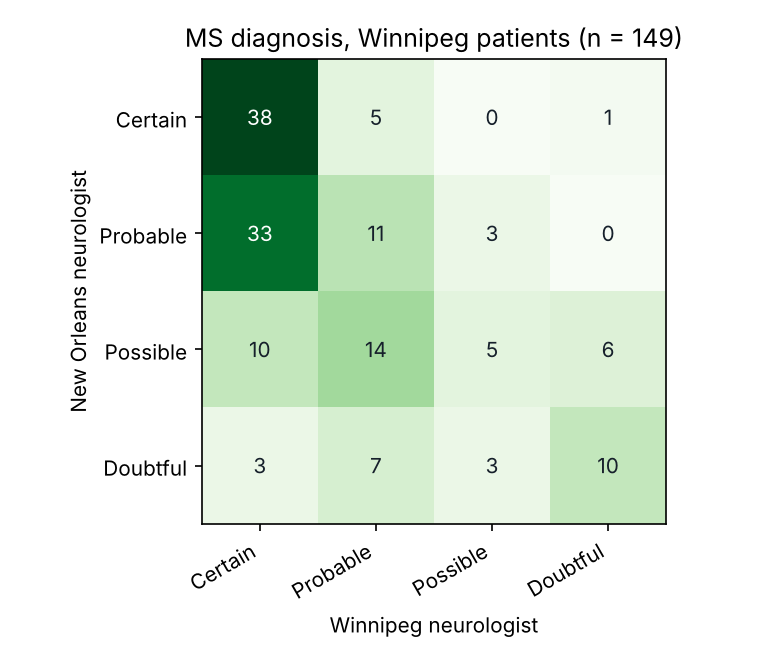

# Rater Agreement Toolkit

When two people rate the same thing, how much do they really agree, and is one
of them systematically stricter? This Python toolkit answers that with the
standard statistics from psychology and clinical research. The same checks are
used by AI-training teams to audit annotation quality.



## Findings on real clinical ratings

**Mammograms** (two radiologists, 110 films, 4 severity levels)
- Raw agreement is 55%, and Cohen's kappa is only 0.37 (fair). Weighting for
  near-misses raises it to 0.76 (substantial): most disagreements are one step
  apart, such as Moderate vs Severe.
- Radiologist 2 rates "Severe" more often (25% vs 15%; Stuart-Maxwell p = .046).

**Multiple sclerosis** (two neurologists, 218 patients from two cities)
- Unweighted kappa is 0.21 for Winnipeg patients and 0.30 for New Orleans
  patients, both only "fair".
- The Winnipeg neurologist calls 56% of Winnipeg patients "Certain" MS, against
  30% for the New Orleans neurologist (Stuart-Maxwell p < .001). The single
  biggest disagreement is 33 patients the New Orleans neurologist called
  "Probable" and the Winnipeg neurologist called "Certain". That is a
  systematic lenient-vs-strict difference, not random noise, and it is exactly
  what an annotation lead would want to catch and fix with clearer guidelines.

Full tables: [reports/report.md](reports/report.md).

## What it computes

| Metric | Use |
| --- | --- |
| Percent agreement | Raw agreement, ignoring chance |
| Cohen's kappa (unweighted, linear, quadratic) | Two raters; weighted versions give partial credit on ordered scales |
| Fleiss' kappa | Any number of raters, every item rated by all |
| Krippendorff's alpha (nominal, ordinal, interval) | Any number of raters, with missing ratings |
| Bootstrap 95% confidence intervals | How precise each kappa is |
| Specific agreement per category | Which labels raters find hardest |
| Stuart-Maxwell test | Whether one rater uses some categories more than the other |
| Landis & Koch labels | Plain-English interpretation |

Every metric is written from its formula and **checked in the tests against an
independent library**: scikit-learn (Cohen's kappa, all weightings),
statsmodels (Fleiss' kappa) and the `krippendorff` package (all three levels,
with missing data). The mammogram kappas also match the published values from
R's `vcd` package.

## Run it

```bash
pip install -r requirements.txt

# the clinical demos
python agree.py demo --out reports

# your own annotation data: one row per rating, columns item, rater, label
python agree.py annotations ratings.csv --order bad ok good --level ordinal
```

The `annotations` mode prints Krippendorff's alpha and Fleiss' kappa and lists
the items with the most disagreement, so they can be reviewed or the
guidelines clarified.

## Tests

```bash
pytest --cov=agreement --cov=agree
```

25 tests, 99% coverage.

## Data

Both datasets come from R packages, redistributed via the Rdatasets collection:
`Mammograms` from `vcdExtra` and `MSPatients` from `vcd` (Landis & Koch, 1977).
`ms_patients.csv` rows are the New Orleans neurologist's ratings; columns are
the Winnipeg neurologist's ratings, split by where the patients were seen.
