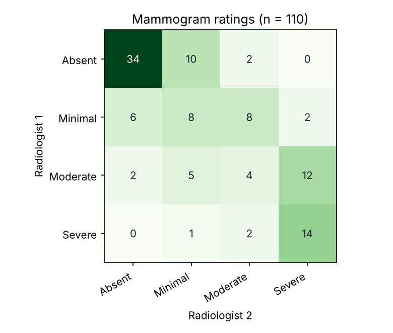
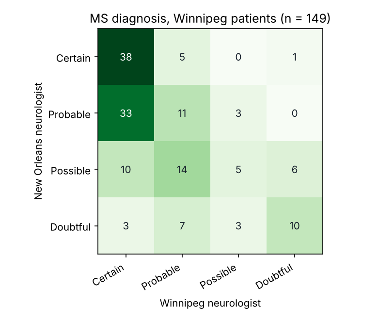
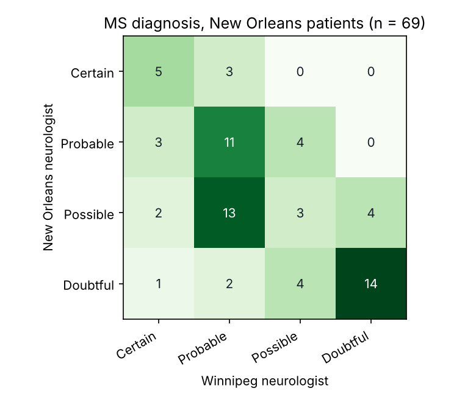

# Inter-Rater Agreement Report

## Mammograms: two radiologists

110 items rated by Radiologist 1 and Radiologist 2. Raw agreement 55%.

| Cohen's kappa | value | 95% bootstrap CI | Landis & Koch |
| --- | --- | --- | --- |
| unweighted | 0.371 | 0.25 to 0.48 | fair |
| linear | 0.596 | 0.49 to 0.68 | moderate |
| quadratic | 0.764 | 0.67 to 0.83 | substantial |

Krippendorff's alpha (ordinal): 0.760.

Agreement by category (specific agreement): Absent 77%, Minimal 33%, Moderate 21%, Severe 62%.
Most common disagreements (Radiologist 1 → Radiologist 2): Moderate → Severe (12 items); Absent → Minimal (10 items); Minimal → Moderate (8 items).

Do the raters use the categories at the same rate? Stuart-Maxwell chi2(3) = 8.00, p 0.046.

| category | Radiologist 1 | Radiologist 2 |
| --- | --- | --- |
| Absent | 42% | 38% |
| Minimal | 22% | 22% |
| Moderate | 21% | 15% |
| Severe | 15% | 25% |

## Multiple sclerosis: Winnipeg patients

149 items rated by New Orleans neurologist and Winnipeg neurologist. Raw agreement 43%.

| Cohen's kappa | value | 95% bootstrap CI | Landis & Koch |
| --- | --- | --- | --- |
| unweighted | 0.208 | 0.11 to 0.31 | fair |
| linear | 0.380 | 0.28 to 0.48 | fair |
| quadratic | 0.525 | 0.40 to 0.63 | moderate |

Krippendorff's alpha (ordinal): 0.457.

Agreement by category (specific agreement): Certain 59%, Probable 26%, Possible 22%, Doubtful 50%.
Most common disagreements (New Orleans neurologist → Winnipeg neurologist): Probable → Certain (33 items); Possible → Probable (14 items); Possible → Certain (10 items).

Do the raters use the categories at the same rate? Stuart-Maxwell chi2(3) = 41.99, p < .001.

| category | New Orleans neurologist | Winnipeg neurologist |
| --- | --- | --- |
| Certain | 30% | 56% |
| Probable | 32% | 25% |
| Possible | 23% | 7% |
| Doubtful | 15% | 11% |

## Multiple sclerosis: New Orleans patients

69 items rated by New Orleans neurologist and Winnipeg neurologist. Raw agreement 48%.

| Cohen's kappa | value | 95% bootstrap CI | Landis & Koch |
| --- | --- | --- | --- |
| unweighted | 0.297 | 0.15 to 0.45 | fair |
| linear | 0.477 | 0.33 to 0.61 | moderate |
| quadratic | 0.626 | 0.45 to 0.76 | substantial |

Krippendorff's alpha (ordinal): 0.615.

Agreement by category (specific agreement): Certain 53%, Probable 47%, Possible 18%, Doubtful 72%.
Most common disagreements (New Orleans neurologist → Winnipeg neurologist): Possible → Probable (13 items); Probable → Possible (4 items); Possible → Doubtful (4 items).

Do the raters use the categories at the same rate? Stuart-Maxwell chi2(3) = 9.15, p 0.027.

| category | New Orleans neurologist | Winnipeg neurologist |
| --- | --- | --- |
| Certain | 12% | 16% |
| Probable | 26% | 42% |
| Possible | 32% | 16% |
| Doubtful | 30% | 26% |

